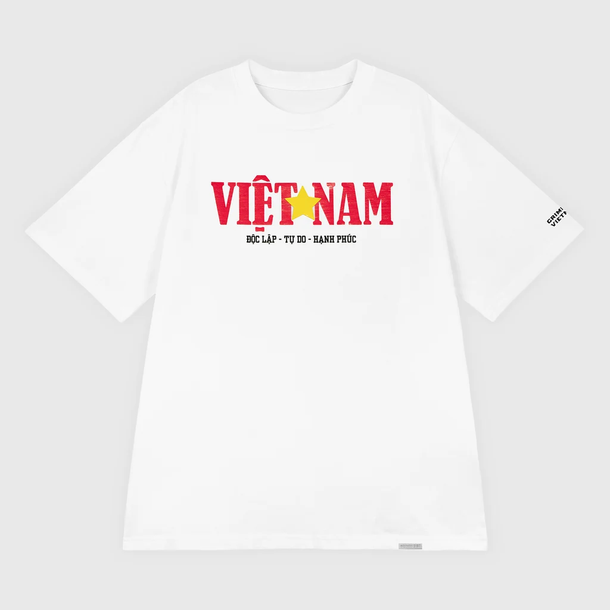
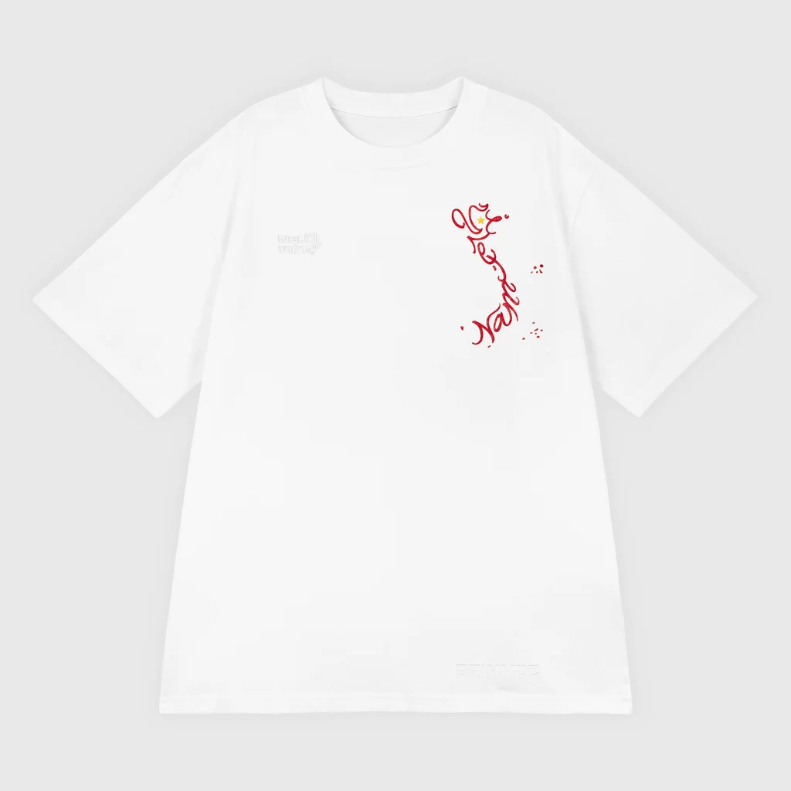
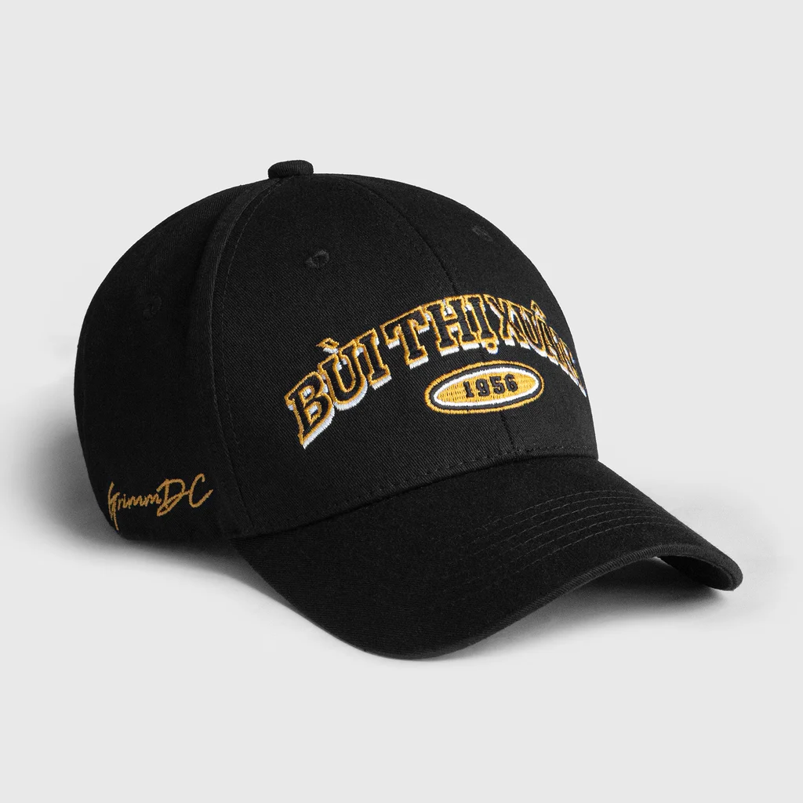
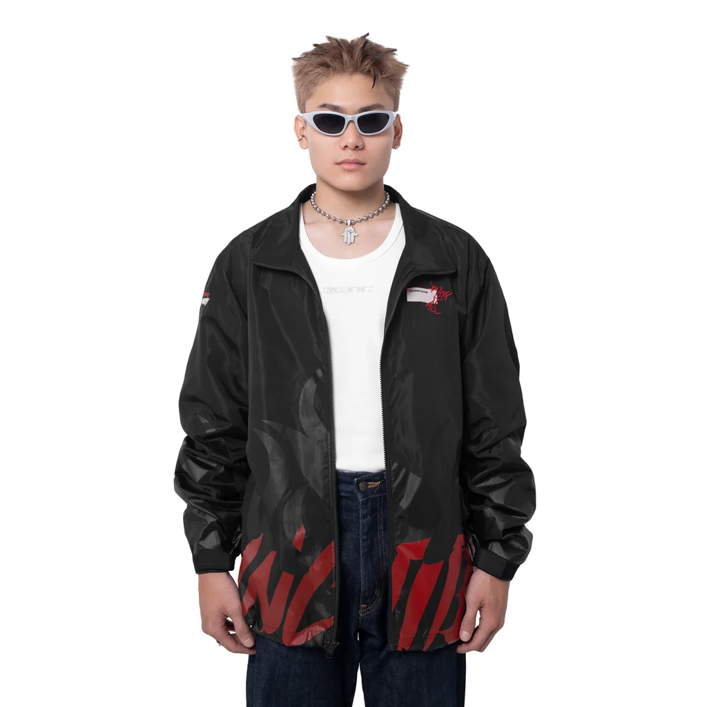
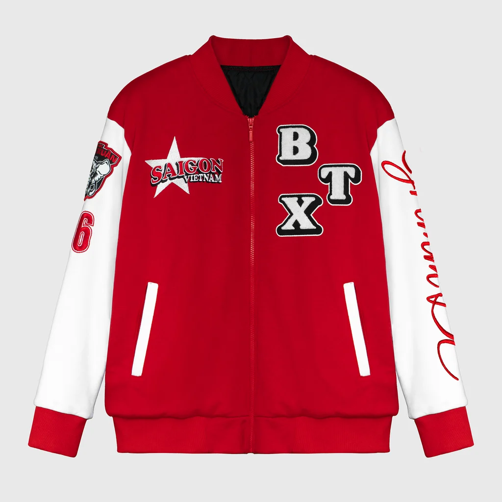
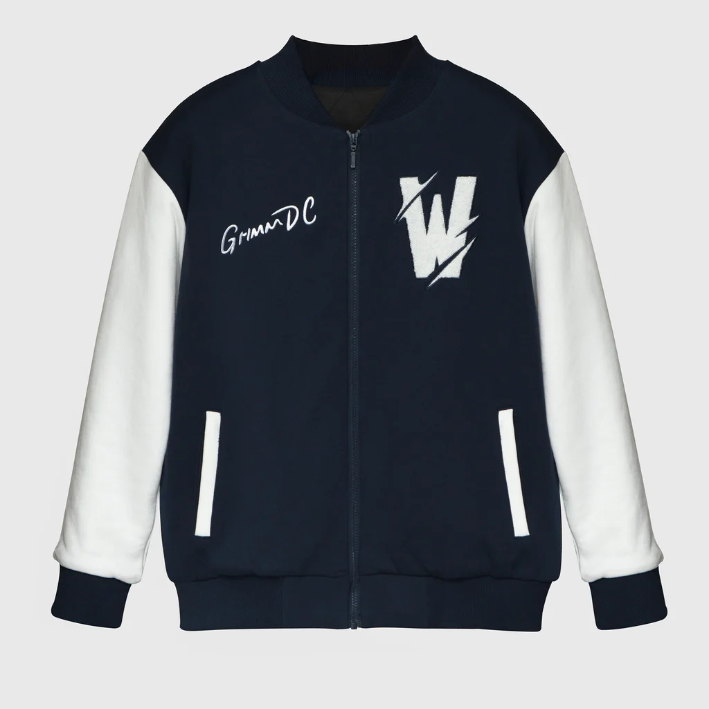
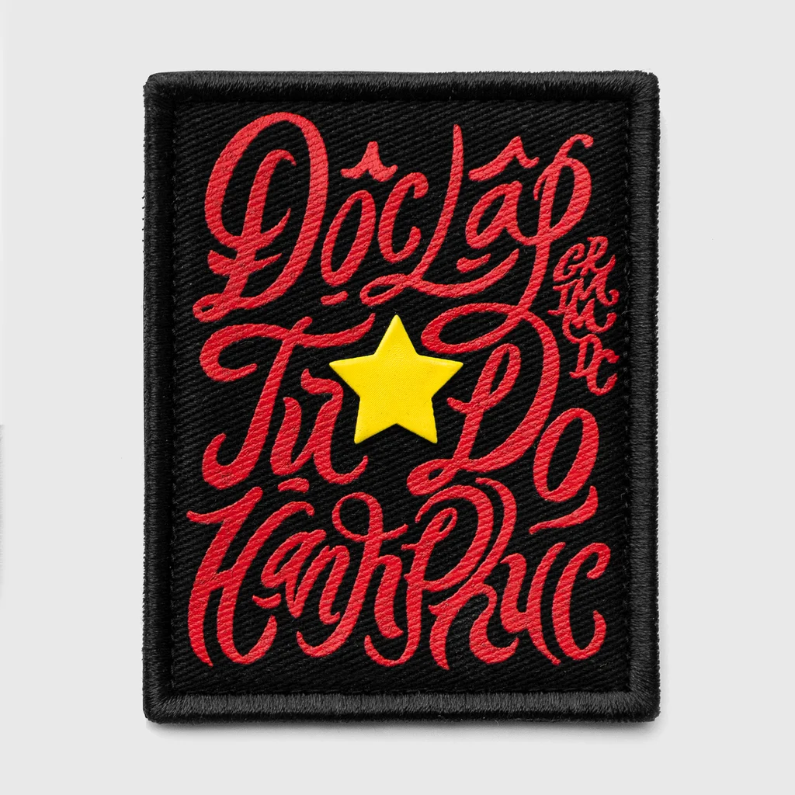

# Buổi 1

## 1. Công cụ AI
Tên công cụ: Gemini

## 2. Mục đích sử dụng
Phân tích giao diện website hiện có, tạo mã nguồn và giải thích HTML/CSS, đề xuất bố cục cải tiến khu vực giỏ hàng cho website.

## 3. Prompt đã sử dụng
### Prompt Phân tích website:
Bạn là chuyên gia phân tích nghiệp vụ và thiết kế trải nghiệm người dùng
cho website thương mại điện tử.

Tôi đang khảo sát website: GrimmDC - https://grimmdc.com/
Hãy giúp tôi lập bảng phân tích các khu vực:
1. Trang chủ.
2. Danh mục sản phẩm.
3. Chi tiết sản phẩm.
4. Tìm kiếm.
5. Giỏ hàng.

Với mỗi khu vực, hãy nêu:
- Mục đích của chức năng.
- Thành phần giao diện cần có.
- Điểm thuận tiện đối với khách hàng.
- Một vấn đề có thể phát sinh.
- Một đề xuất cải tiến.

### Prompt Cải tiến
Tôi đang thực hiện bài tập phát triển giao diện website thương mại điện tử
bằng HTML5 và CSS3.

Tôi muốn cải tiến khu vực: Thiết kế phần tóm tắt giỏ hàng (Slide-out Cart)
Đối tượng sử dụng: khách hàng mua sắm trực tuyến tại Việt Nam.

Hãy đề xuất:
1. Bố cục giao diện.
2. Các thành phần HTML cần sử dụng.
3. Cách tổ chức CSS.
4. Cách hiển thị trên máy tính và điện thoại.
5. Những điểm cần kiểm tra về khả năng sử dụng.

Trước tiên, hãy giải thích phương án thiết kế.
Chưa tạo toàn bộ mã nguồn cho đến khi tôi yêu cầu.

### Prompt tạo mã nguồn
Dựa trên phương án đã thống nhất, hãy tạo một trang giao diện
thương mại điện tử bằng HTML5 và CSS3.

Yêu cầu:
- Giao diện có tiêu đề và khu vực sản phẩm.
- Có tối thiểu 4 sản phẩm mẫu.
- Mỗi sản phẩm có hình ảnh, tên, giá và nút thao tác.
- Bố cục phù hợp với màn hình máy tính và điện thoại.
- Mã HTML có cấu trúc rõ ràng.
- CSS được tách thành file riêng.
- Không sử dụng backend hoặc cơ sở dữ liệu.
- Không đưa thư viện hoặc thành phần không cần thiết vào dự án.

Giải thích cách chạy trang web và những phần tôi cần kiểm tra.

## 4. Kết quả AI đề xuất
- **Về phân tích:** AI nhận diện tốt cấu trúc chức năng thương mại điện tử, chỉ ra rủi ro gián đoạn quy trình thanh toán nếu khách hàng không thể chỉnh sửa size/màu trong giỏ hàng. 
- **Về kiến trúc giao diện:** AI đề xuất cấu trúc 5 khối cho Drawer (`Header`, `Freeship Banner`, `Cart Body List`, `Cross-sell Section`, `Footer Checkout CTA`).
- **Về kỹ thuật lập trình:** AI cung cấp khung HTML ngữ nghĩa (`<aside>`, `<header>`, `<ul>`, `<li>`, `<footer>`) và giải pháp chuyển động mượt bằng `transform: translateX(100%)` sang `translateX(0)`.

## 5. Kiểm tra, đối chiếu và điều chỉnh của sinh viên
- **Loại bỏ thông tin chưa chính xác:** AI ban đầu đưa ra nhận định chung chung rằng website chưa có giỏ hàng mini. Khi kiểm tra thực tế trên web Grimm DC, hãng đã có drawer mini trượt ngang, điểm hạn chế thực sự là thiếu tính năng đổi size trực tiếp và thiếu gợi ý phụ kiện thông minh. Sinh viên đã điều chỉnh lại đúng bản chất thực tế của website. Ngoài ra, AI có nhầm lẫn khi UI của website gốc ở bản mobile đã tối ưu ở các thanh BST (không bị quá dài hay quá to) nhưng AI đưa ra nhận định là không fit giao diện mobile dẫn đến các thanh BST che hết màn hình.
- **Cá nhân hóa dữ liệu cho Grimm DC:** Thay thế các sản phẩm chung chung của AI bằng đúng sản phẩm đặc trưng của hãng: *Áo thun Bùi Thị Xuân, Nón thêu Thủ Đô, Áo wash Độc Lập - Tự Do - Hạnh Phúc*, và phụ kiện mua kèm là *Miếng dán gai (Velcro Patch) 70.000₫*.
- **Tự sửa và bổ sung mã nguồn:**
  - Bổ sung đơn vị `100dvh` (Dynamic Viewport Height) cho CSS mobile thay vì chỉ dùng `100vh` để tránh bị thanh địa chỉ trình duyệt trên điện thoại đè che mất nút thanh toán.
  - Bổ sung `padding-bottom: calc(16px + env(safe-area-inset-bottom))` bảo vệ vùng phím điều hướng cử chỉ của iOS/Android.
  - Tự thiết lập `overscroll-behavior: contain;` ở phần cuộn sản phẩm để ngăn hiện tượng cuộn giật lây lan ra trang web nền.

## 6. Phần sinh viên hiểu và có thể tự giải thích
1. **Kiến trúc Semantic HTML5 & Accessibility:**
   - Thẻ `<aside role="dialog" aria-modal="true">`: Định danh ngăn kéo là một hộp thoại nổi tách biệt với luồng trang chính, hỗ trợ tốt cho trình đọc màn hình.
   - Thẻ `<select class="variant-select">` kết hợp `<option>`: Cho phép khách hàng đổi size ngay tại giỏ hàng mà không cần tải lại trang.
2. **Kỹ thuật CSS Flexbox & Drawer Layout:**
   - Cặp thuộc tính `flex-shrink: 0` (cho Header, Freeship Banner, Footer) và `flex-grow: 1; overflow-y: auto;` (cho phần thân chứa danh sách sản phẩm) đảm bảo giao diện luôn cố định 2 đầu nút bấm quan trọng và cuộn mượt ở giữa.
3. **Hiệu năng chuyển động (GPU Rendering):**
   - Sử dụng `transform: translateX(100%)` kết hợp thuộc tính `will-change: transform` giúp trình duyệt dựng hình bằng card đồ họa phần cứng, tránh kích hoạt lại quy trình tính toán Layout/Repaint đắt đỏ so với cách dùng `right: -440px`.
4. **Tư duy kinh doanh E-commerce áp dụng vào kỹ thuật:**
   - Cơ chế Freeship Progress Bar và Dynamic Cross-sell tác động trực tiếp vào tâm lý tránh phí vận chuyển của người mua hàng Việt Nam, giúp tối ưu chỉ số AOV (Average Order Value) của website.

# Buổi 2

## 1. Công cụ AI
Tên công cụ: Claude

## 2. Prompt 1 – Phân tích mã nguồn hiện tại
```text
Tôi đang làm bài tập cá nhân môn Phát triển ứng dụng thương mại điện tử.

Trong Buổi 1, tôi đã khảo sát một website TMĐT và tạo một giao diện cải tiến bằng HTML/CSS.

Đây là mã HTML hiện tại:
<!DOCTYPE html>
<html lang="vi">
<head>
  <meta charset="UTF-8">
  <meta name="viewport" content="width=device-width, initial-scale=1.0">
  <title>Grimm DC Concept Store | Cửa hàng trực tuyến</title>
  <link rel="stylesheet" href="css/style.css">
</head>
<body>

  <!-- ================= HEADER CHÍNH ================= -->
  <header class="site-header">
    <div class="container header-inner">
      <a href="#" class="brand-logo">GRIMM DC</a>

      <!-- Menu Navigation danh mục -->
      <nav class="main-nav">
        <ul>
          <li><a href="#" class="nav-filter active" data-filter="all">Bộ sưu tập</a></li>
          <li><a href="#" class="nav-filter" data-filter="ao-thun">Áo thun</a></li>
          <li><a href="#" class="nav-filter" data-filter="ao-khoac">Áo khoác</a></li>
          <li><a href="#" class="nav-filter" data-filter="phu-kien">Phụ kiện</a></li>
        </ul>
      </nav>

      <div class="header-actions">
        <a href="#cart-drawer" class="cart-trigger-btn" id="open-cart-btn" aria-label="Mở giỏ hàng">
          <svg width="22" height="22" viewBox="0 0 24 24" fill="none" stroke="currentColor" stroke-width="2" stroke-linecap="round" stroke-linejoin="round">
            <path d="M6 2L3 6v14a2 2 0 0 0 2 2h14a2 2 0 0 0 2-2V6l-3-4z"></path>
            <line x1="3" y1="6" x2="21" y2="6"></line>
            <path d="M16 10a4 4 0 0 1-8 0"></path>
          </svg>
          <span class="cart-badge" id="cart-badge-count">2</span>
        </a>
      </div>
    </div>
  </header>

  <!-- ================= NỘI DUNG CHÍNH ================= -->
  <main class="main-content">
    <div class="container">

      <section class="catalog-heading">
        <span class="category-sub">Dự án Văn hóa & Lịch sử</span>
        <h1 class="category-title" id="catalog-title">Tất cả sản phẩm</h1>
        <p class="category-desc">Khám phá các thiết kế mang tinh thần đường phố đương đại kết hợp cùng câu chuyện bản sắc Việt Nam.</p>
      </section>

      <!-- Danh sách 8 sản phẩm (Dùng ảnh .webp) -->
      <section class="product-grid" aria-label="Danh sách sản phẩm">

        <!-- SP 1: Áo Độc Lập -->
        <article class="product-card" data-category="ao-thun">
          <div class="product-thumb">
            <span class="badge discount-badge">-15%</span>
            
          </div>
          <div class="product-details">
            <span class="product-tag">Áo thun</span>
            <h2 class="product-name">Áo Độc Lập - Tự Do - Hạnh Phúc // Trắng</h2>
            <div class="product-pricing">
              <span class="price-current">380.000₫</span>
              <del class="price-original">450.000₫</del>
            </div>
            <button type="button" class="btn btn-add-card" data-name="Áo Độc Lập - Tự Do - Hạnh Phúc // Trắng" data-price="380000" data-variant="Size: M" data-img="images/ao-doc-lap.webp">Thêm vào giỏ</button>
          </div>
        </article>

        <!-- SP 2: Áo Người Việt Nam -->
        <article class="product-card" data-category="ao-thun">
          <div class="product-thumb">
            <span class="badge new-badge">Mới</span>
            
          </div>
          <div class="product-details">
            <span class="product-tag">Áo thun</span>
            <h2 class="product-name">Áo Người Việt Nam // Đen</h2>
            <div class="product-pricing">
              <span class="price-current">420.000₫</span>
            </div>
            <button type="button" class="btn btn-add-card" data-name="Áo Người Việt Nam // Đen" data-price="420000" data-variant="Size: M" data-img="images/ao-nguoi-viet-nam.webp">Thêm vào giỏ</button>
          </div>
        </article>

        <!-- SP 3: Nón BTX -->
        <article class="product-card" data-category="phu-kien">
          <div class="product-thumb">
            
          </div>
          <div class="product-details">
            <span class="product-tag">Phụ kiện</span>
            <h2 class="product-name">Nón BTX x Grimm DC</h2>
            <div class="product-pricing">
              <span class="price-current">350.000₫</span>
            </div>
            <button type="button" class="btn btn-add-card" data-name="Nón BTX x Grimm DC" data-price="350000" data-variant="Màu: Đen / Freesize" data-img="images/non-btx.webp">Thêm vào giỏ</button>
          </div>
        </article>

        <!-- SP 4: Áo khoác SINCITY -->
        <article class="product-card" data-category="ao-khoac">
          <div class="product-thumb">
            <span class="badge discount-badge">-10%</span>
            
          </div>
          <div class="product-details">
            <span class="product-tag">Áo khoác</span>
            <h2 class="product-name">Áo khoác SINCITY</h2>
            <div class="product-pricing">
              <span class="price-current">650.000₫</span>
              <del class="price-original">720.000₫</del>
            </div>
            <button type="button" class="btn btn-add-card" data-name="Áo khoác SINCITY" data-price="650000" data-variant="Size: L" data-img="images/ao-khoac-sincity.webp">Thêm vào giỏ</button>
          </div>
        </article>

        <!-- SP 5: Bomber BTX -->
        <article class="product-card" data-category="ao-khoac">
          <div class="product-thumb">
            <span class="badge discount-badge">-38%</span>
            
          </div>
          <div class="product-details">
            <span class="product-tag">Áo khoác</span>
            <h2 class="product-name">Áo bomber BTX x Grimm DC</h2>
            <div class="product-pricing">
              <span class="price-current">749.000₫</span>
              <del class="price-original">1.200.000₫</del>
            </div>
            <button type="button" class="btn btn-add-card" data-name="Áo bomber BTX x Grimm DC" data-price="749000" data-variant="Size: L" data-img="images/bomber-btx.webp">Thêm vào giỏ</button>
          </div>
        </article>

        <!-- SP 6: Bomber TWxGR -->
        <article class="product-card" data-category="ao-khoac">
          <div class="product-thumb">
            
          </div>
          <div class="product-details">
            <span class="product-tag">Áo khoác</span>
            <h2 class="product-name">Bomber TWxGR</h2>
            <div class="product-pricing">
              <span class="price-current">699.000₫</span>
            </div>
            <button type="button" class="btn btn-add-card" data-name="Bomber TWxGR" data-price="699000" data-variant="Size: L" data-img="images/bomber-twxgr.webp">Thêm vào giỏ</button>
          </div>
        </article>

        <!-- SP 7: Miếng dán gai cờ Việt Nam -->
        <article class="product-card" data-category="phu-kien">
          <div class="product-thumb">
            <span class="badge discount-badge">-22%</span>
            
          </div>
          <div class="product-details">
            <span class="product-tag">Phụ kiện</span>
            <h2 class="product-name">Miếng dán gai cờ Việt Nam 2.3x5cm</h2>
            <div class="product-pricing">
              <span class="price-current">70.000₫</span>
              <del class="price-original">89.000₫</del>
            </div>
            <button type="button" class="btn btn-add-card" data-name="Miếng dán gai cờ Việt Nam 2.3x5cm" data-price="70000" data-variant="Kích thước: 2.3x5cm" data-img="images/patch-co-vn.webp">Thêm vào giỏ</button>
          </div>
        </article>

        <!-- SP 8: Miếng dán gai Độc Lập -->
        <article class="product-card" data-category="phu-kien">
          <div class="product-thumb">
            <span class="badge discount-badge">-22%</span>
            
          </div>
          <div class="product-details">
            <span class="product-tag">Phụ kiện</span>
            <h2 class="product-name">Miếng dán gai Độc Lập - Tự Do - Hạnh Phúc 7.8x6.2cm</h2>
            <div class="product-pricing">
              <span class="price-current">70.000₫</span>
              <del class="price-original">89.000₫</del>
            </div>
            <button type="button" class="btn btn-add-card" data-name="Miếng dán gai Độc Lập - Tự Do - Hạnh Phúc 7.8x6.2cm" data-price="70000" data-variant="Kích thước: 7.8x6.2cm" data-img="images/patch-doc-lap.webp">Thêm vào giỏ</button>
          </div>
        </article>

      </section>
    </div>
  </main>

  <!-- ================= TÓM TẮT GIỎ HÀNG (SLIDE-OUT CART) ================= -->
  <div class="cart-backdrop" id="cart-backdrop" aria-hidden="true"></div>

  <aside class="cart-drawer" id="cart-drawer" role="dialog" aria-modal="true" aria-labelledby="cart-title">

    <header class="cart-header">
      <div class="cart-header-title">
        <h2 id="cart-title">Giỏ hàng của bạn</h2>
        <span class="cart-count-label" id="cart-count-label">(2 món)</span>
      </div>
      <a href="#" class="cart-close-btn" id="close-cart-btn" aria-label="Đóng giỏ hàng">&times;</a>
    </header>

    <!-- Giá trị tĩnh: tạm tính 730.000₫ → còn thiếu 70.000₫ (ngưỡng freeship 800.000₫) -->
    <section class="cart-freeship-banner">
      <p class="freeship-text" id="freeship-text">Mua thêm <strong class="highlight-price">70.000₫</strong> để được <strong>Miễn phí vận chuyển</strong></p>
      <div class="progress-bar-track">
        <div class="progress-bar-fill" id="freeship-progress-fill" style="width: 91%;"></div>
      </div>
    </section>

    <div class="cart-body">
      <ul class="cart-item-list" id="cart-item-list">

        <!-- Mục 1 mặc định trong giỏ -->
        <li class="cart-item" data-price="380000" data-name="Áo Độc Lập - Tự Do - Hạnh Phúc // Trắng">
          
          <div class="cart-item-info">
            <h3 class="cart-item-name">Áo Độc Lập - Tự Do - Hạnh Phúc // Trắng</h3>
            <div class="cart-item-pricing">
              <span class="price">380.000₫</span>
            </div>

            <div class="cart-item-variant">
              <label for="variant-item-1">Kích cỡ:</label>
              <select id="variant-item-1" class="variant-select">
                <option value="S">S</option>
                <option value="M" selected>M</option>
                <option value="L">L</option>
                <option value="XL" disabled>XL (Hết)</option>
              </select>
            </div>

            <div class="cart-item-actions">
              <div class="quantity-control">
                <button type="button" class="qty-btn btn-qty-minus" aria-label="Giảm số lượng">-</button>
                <input type="number" class="qty-input" value="1" min="1" max="10" readonly>
                <button type="button" class="qty-btn btn-qty-plus" aria-label="Tăng số lượng">+</button>
              </div>
              <button type="button" class="item-remove-btn">Xóa</button>
            </div>
          </div>
        </li>

        <!-- Mục 2 mặc định trong giỏ -->
        <li class="cart-item" data-price="350000" data-name="Nón BTX x Grimm DC">
          
          <div class="cart-item-info">
            <h3 class="cart-item-name">Nón BTX x Grimm DC</h3>
            <div class="cart-item-pricing">
              <span class="price">350.000₫</span>
            </div>

            <div class="cart-item-variant">
              <span class="variant-fixed">Màu: Đen / Freesize</span>
            </div>

            <div class="cart-item-actions">
              <div class="quantity-control">
                <button type="button" class="qty-btn btn-qty-minus" aria-label="Giảm số lượng">-</button>
                <input type="number" class="qty-input" value="1" min="1" max="10" readonly>
                <button type="button" class="qty-btn btn-qty-plus" aria-label="Tăng số lượng">+</button>
              </div>
              <button type="button" class="item-remove-btn">Xóa</button>
            </div>
          </div>
        </li>

      </ul>

      <!-- Khối Cross-sell (nội dung tĩnh) -->
      <section class="cart-cross-sell" id="cross-sell-section">
        <h4 class="cross-sell-title" id="cross-sell-title">Gợi ý mua kèm để đạt Freeship</h4>
        <div class="cross-sell-card" id="cross-sell-card-content">
          
          <div class="cross-sell-info">
            <p class="cross-sell-name">Miếng dán gai cờ Việt Nam 2.3x5cm</p>
            <p class="cross-sell-price">70.000₫</p>
          </div>
          <button type="button" class="btn btn-add-cross"
                  data-name="Miếng dán gai cờ Việt Nam 2.3x5cm"
                  data-price="70000"
                  data-img="images/patch-co-vn.webp"
                  data-variant="Kích thước: 2.3x5cm">+ Thêm</button>
        </div>
      </section>
    </div>

    <footer class="cart-footer">
      <div class="cart-summary-row">
        <span class="summary-label">Tạm tính:</span>
        <span class="summary-value" id="cart-subtotal">730.000₫</span>
      </div>
      <p class="cart-shipping-note">Phí vận chuyển và mã giảm giá sẽ được áp dụng ở bước tiếp theo.</p>

      <a href="#" class="btn btn-checkout">
        <span>TIẾN HÀNH THANH TOÁN</span>
        <span class="btn-checkout-price" id="btn-checkout-price">730.000₫</span>
      </a>

      <a href="#" class="btn btn-continue-shopping" id="continue-shopping-btn">Tiếp tục mua sắm</a>
    </footer>

  </aside>

</body>
</html>

Đây là mã CSS hiện tại nếu có:
/* ==========================================================================
   1. RESET & BIẾN CSS TOÀN CỤC
   ========================================================================== */
:root {
  --color-primary: #111111;
  --color-accent: #e53935;
  --color-bg: #f8f8f8;
  --color-card-bg: #ffffff;
  --color-text-main: #1a1a1a;
  --color-text-muted: #666666;
  --color-border: #e5e5e5;
  
  --font-family: -apple-system, BlinkMacSystemFont, "Segoe UI", Roboto, Helvetica, Arial, sans-serif;
  --drawer-width: 440px;
  --transition-speed: 0.35s;
  --ease-out-cubic: cubic-bezier(0.16, 1, 0.3, 1);
}

*, *::before, *::after {
  box-sizing: border-box;
  margin: 0;
  padding: 0;
}

body {
  font-family: var(--font-family);
  background-color: var(--color-bg);
  color: var(--color-text-main);
  line-height: 1.5;
  -webkit-font-smoothing: antialiased;
}

/* Khóa cuộn trang khi mở giỏ hàng */
body.body-lock-scroll {
  overflow: hidden;
}

a {
  text-decoration: none;
  color: inherit;
}

ul {
  list-style: none;
}

img {
  max-width: 100%;
  display: block;
}

button, input, select {
  font-family: inherit;
}

.container {
  width: 100%;
  max-width: 1200px;
  margin: 0 auto;
  padding: 0 20px;
}

/* ==========================================================================
   2. SITE HEADER
   ========================================================================== */
.site-header {
  background-color: #ffffff;
  border-bottom: 1px solid var(--color-border);
  position: sticky;
  top: 0;
  z-index: 100;
}

.header-inner {
  display: flex;
  align-items: center;
  justify-content: space-between;
  height: 70px;
}

.brand-logo {
  font-size: 1.35rem;
  font-weight: 800;
  letter-spacing: 2px;
}

.main-nav ul {
  display: flex;
  gap: 28px;
}

.main-nav a {
  font-size: 0.95rem;
  font-weight: 500;
  color: var(--color-text-muted);
  transition: color 0.2s ease;
}

.main-nav a:hover,
.main-nav a.active {
  color: var(--color-primary);
}

.cart-trigger-btn {
  background: none;
  border: none;
  cursor: pointer;
  position: relative;
  display: flex;
  align-items: center;
  justify-content: center;
  padding: 8px;
  color: var(--color-primary);
}

.cart-badge {
  position: absolute;
  top: 2px;
  right: 0;
  background-color: var(--color-primary);
  color: #ffffff;
  font-size: 0.7rem;
  font-weight: 700;
  min-width: 18px;
  height: 18px;
  line-height: 18px;
  border-radius: 50%;
  text-align: center;
}

/* ==========================================================================
   3. CATALOG & PRODUCT GRID
   ========================================================================== */
.main-content {
  padding: 40px 0 80px;
}

.catalog-heading {
  text-align: center;
  margin-bottom: 40px;
}

.category-sub {
  font-size: 0.85rem;
  font-weight: 600;
  text-transform: uppercase;
  letter-spacing: 1.5px;
  color: var(--color-text-muted);
  display: block;
  margin-bottom: 8px;
}

.category-title {
  font-size: 2rem;
  font-weight: 800;
  letter-spacing: -0.5px;
  margin-bottom: 10px;
}

.category-desc {
  color: var(--color-text-muted);
  max-width: 600px;
  margin: 0 auto;
  font-size: 0.95rem;
}

.product-grid {
  display: grid;
  grid-template-columns: repeat(4, 1fr);
  gap: 24px;
}

.product-card {
  background-color: var(--color-card-bg);
  border: 1px solid var(--color-border);
  border-radius: 8px;
  overflow: hidden;
  display: flex;
  flex-direction: column;
  transition: transform 0.2s ease, box-shadow 0.2s ease;
}

.product-card:hover {
  transform: translateY(-4px);
  box-shadow: 0 10px 20px rgba(0, 0, 0, 0.05);
}

.product-thumb {
  position: relative;
  background-color: #eee;
  aspect-ratio: 1 / 1.15;
  overflow: hidden;
}

.product-thumb img {
  width: 100%;
  height: 100%;
  object-fit: cover;
  transition: transform 0.4s ease;
}

.product-card:hover .product-thumb img {
  transform: scale(1.05);
}

.badge {
  position: absolute;
  top: 12px;
  left: 12px;
  padding: 4px 8px;
  font-size: 0.75rem;
  font-weight: 700;
  border-radius: 4px;
  text-transform: uppercase;
}

.discount-badge {
  background-color: var(--color-accent);
  color: #fff;
}

.new-badge {
  background-color: var(--color-primary);
  color: #fff;
}

.product-details {
  padding: 16px;
  display: flex;
  flex-direction: column;
  flex-grow: 1;
}

.product-tag {
  font-size: 0.75rem;
  color: var(--color-text-muted);
  text-transform: uppercase;
  margin-bottom: 6px;
}

.product-name {
  font-size: 0.95rem;
  font-weight: 600;
  line-height: 1.4;
  margin-bottom: 12px;
  flex-grow: 1;
}

.product-pricing {
  display: flex;
  align-items: baseline;
  gap: 10px;
  margin-bottom: 16px;
}

.price-current {
  font-weight: 700;
  font-size: 1.1rem;
  color: var(--color-primary);
}

.price-original {
  font-size: 0.85rem;
  color: var(--color-text-muted);
}

.btn {
  display: inline-flex;
  align-items: center;
  justify-content: center;
  padding: 10px 16px;
  border-radius: 6px;
  font-size: 0.9rem;
  font-weight: 600;
  cursor: pointer;
  border: none;
  transition: all 0.2s ease;
}

.btn-add-card {
  width: 100%;
  background-color: #ffffff;
  color: var(--color-primary);
  border: 1px solid var(--color-primary);
}

.btn-add-card:hover {
  background-color: var(--color-primary);
  color: #ffffff;
}

/* ==========================================================================
   4. SLIDE-OUT CART (NGĂN KÉO GIỎ HÀNG)
   ========================================================================== */
/* Lớp phủ mờ nền */
.cart-backdrop {
  position: fixed;
  inset: 0;
  background-color: rgba(0, 0, 0, 0.55);
  backdrop-filter: blur(2px);
  z-index: 998;
  opacity: 0;
  visibility: hidden;
  transition: opacity var(--transition-speed) ease, visibility var(--transition-speed);
}

.cart-backdrop.is-open {
  opacity: 1;
  visibility: visible;
}

/* Khung trượt chính */
.cart-drawer {
  position: fixed;
  top: 0;
  right: 0;
  width: 100%;
  max-width: var(--drawer-width);
  height: 100vh;
  height: 100dvh; /* Tương thích tốt màn hình di động */
  background-color: #ffffff;
  z-index: 999;
  display: flex;
  flex-direction: column;
  transform: translateX(100%);
  transition: transform var(--transition-speed) var(--ease-out-cubic);
  box-shadow: -10px 0 30px rgba(0, 0, 0, 0.15);
}

.cart-drawer.is-open {
  transform: translateX(0);
}

/* Khối 1: Header giỏ hàng */
.cart-header {
  padding: 18px 24px;
  display: flex;
  align-items: center;
  justify-content: space-between;
  border-bottom: 1px solid var(--color-border);
  flex-shrink: 0;
}

.cart-header-title {
  display: flex;
  align-items: baseline;
  gap: 8px;
}

.cart-header-title h2 {
  font-size: 1.15rem;
  font-weight: 700;
}

.cart-count-label {
  font-size: 0.85rem;
  color: var(--color-text-muted);
}

.cart-close-btn {
  background: none;
  border: none;
  font-size: 1.8rem;
  line-height: 1;
  color: var(--color-text-main);
  cursor: pointer;
  padding: 4px;
}

/* Khối 2: Freeship Banner */
.cart-freeship-banner {
  background-color: #fcf8e3;
  padding: 12px 24px;
  border-bottom: 1px solid #faebcc;
  flex-shrink: 0;
}

.freeship-text {
  font-size: 0.85rem;
  color: #8a6d3b;
  margin-bottom: 8px;
  text-align: center;
}

.highlight-price {
  color: var(--color-accent);
}

.progress-bar-track {
  width: 100%;
  height: 6px;
  background-color: #e5e5e5;
  border-radius: 3px;
  overflow: hidden;
}

.progress-bar-fill {
  height: 100%;
  background-color: var(--color-accent);
  border-radius: 3px;
  transition: width 0.3s ease;
}

/* Khối 3: Thân giỏ hàng cuộn độc lập */
.cart-body {
  flex-grow: 1;
  overflow-y: auto;
  overscroll-behavior: contain;
  padding: 16px 24px;
}

.cart-item-list {
  display: flex;
  flex-direction: column;
  gap: 20px;
}

.cart-item {
  display: flex;
  gap: 16px;
  padding-bottom: 20px;
  border-bottom: 1px solid var(--color-border);
}

.cart-item-img {
  width: 76px;
  height: 90px;
  object-fit: cover;
  border-radius: 4px;
  background-color: #f0f0f0;
  flex-shrink: 0;
}

.cart-item-info {
  flex-grow: 1;
  display: flex;
  flex-direction: column;
}

.cart-item-name {
  font-size: 0.9rem;
  font-weight: 600;
  line-height: 1.35;
  margin-bottom: 4px;
}

.cart-item-pricing .price {
  font-size: 0.95rem;
  font-weight: 700;
}

.cart-item-variant {
  margin: 6px 0 10px;
  display: flex;
  align-items: center;
  gap: 6px;
  font-size: 0.8rem;
  color: var(--color-text-muted);
}

.variant-select {
  padding: 2px 6px;
  font-size: 0.8rem;
  border: 1px solid var(--color-border);
  border-radius: 4px;
  background-color: #fff;
  cursor: pointer;
}

.cart-item-actions {
  display: flex;
  align-items: center;
  justify-content: space-between;
  margin-top: auto;
}

.quantity-control {
  display: inline-flex;
  border: 1px solid var(--color-border);
  border-radius: 4px;
  background-color: #fff;
}

.qty-btn {
  width: 28px;
  height: 28px;
  background: none;
  border: none;
  cursor: pointer;
  font-size: 1rem;
  display: flex;
  align-items: center;
  justify-content: center;
  color: var(--color-text-main);
}

.qty-btn:hover {
  background-color: #f0f0f0;
}

.qty-input {
  width: 32px;
  height: 28px;
  border: none;
  border-left: 1px solid var(--color-border);
  border-right: 1px solid var(--color-border);
  text-align: center;
  font-size: 0.85rem;
  font-weight: 600;
  outline: none;
}

.item-remove-btn {
  background: none;
  border: none;
  font-size: 0.8rem;
  color: var(--color-text-muted);
  cursor: pointer;
  text-decoration: underline;
}

.item-remove-btn:hover {
  color: var(--color-accent);
}

/* Khối 4: Cross-sell */
.cart-cross-sell {
  margin-top: 24px;
  padding: 14px;
  background-color: var(--color-bg);
  border-radius: 6px;
}

.cross-sell-title {
  font-size: 0.8rem;
  font-weight: 700;
  text-transform: uppercase;
  letter-spacing: 0.5px;
  margin-bottom: 10px;
  color: var(--color-text-muted);
}

.cross-sell-card {
  display: flex;
  align-items: center;
  gap: 12px;
}

.cross-sell-img {
  width: 48px;
  height: 48px;
  border-radius: 4px;
  object-fit: cover;
  flex-shrink: 0;
}

.cross-sell-info {
  flex-grow: 1;
}

.cross-sell-name {
  font-size: 0.85rem;
  font-weight: 600;
  line-height: 1.25;
}

.cross-sell-price {
  font-size: 0.8rem;
  font-weight: 700;
  color: var(--color-accent);
}

.btn-add-cross {
  padding: 6px 12px;
  font-size: 0.8rem;
  background-color: #ffffff;
  border: 1px solid var(--color-primary);
  color: var(--color-primary);
}

.btn-add-cross:hover {
  background-color: var(--color-primary);
  color: #ffffff;
}

/* Khối 5: Footer giỏ hàng */
.cart-footer {
  padding: 20px 24px;
  border-top: 1px solid var(--color-border);
  background-color: #ffffff;
  flex-shrink: 0;
}

.cart-summary-row {
  display: flex;
  justify-content: space-between;
  align-items: baseline;
  margin-bottom: 8px;
}

.summary-label {
  font-size: 1rem;
  font-weight: 600;
}

.summary-value {
  font-size: 1.25rem;
  font-weight: 800;
  color: var(--color-primary);
}

.cart-shipping-note {
  font-size: 0.75rem;
  color: var(--color-text-muted);
  margin-bottom: 16px;
}

.btn-checkout {
  width: 100%;
  background-color: var(--color-primary);
  color: #ffffff;
  padding: 14px;
  display: flex;
  justify-content: space-between;
  align-items: center;
  border-radius: 6px;
  margin-bottom: 10px;
}

.btn-checkout:hover {
  background-color: #333333;
}

.btn-checkout-price {
  font-weight: 700;
}

.btn-continue-shopping {
  width: 100%;
  background: none;
  border: none;
  color: var(--color-text-muted);
  font-size: 0.85rem;
  cursor: pointer;
  padding: 6px;
}

.btn-continue-shopping:hover {
  text-decoration: underline;
  color: var(--color-primary);
}

/* ==========================================================================
   5. RESPONSIVE (ĐIỆN THOẠI & TABLET)
   ========================================================================== */
@media (max-width: 992px) {
  .product-grid {
    grid-template-columns: repeat(2, 1fr);
    gap: 16px;
  }
}

@media (max-width: 600px) {
  .main-nav {
    display: none; /* Ẩn menu chính trên mobile để giữ thanh header thoáng */
  }

  .header-inner {
    height: 60px;
  }

  .main-content {
    padding: 24px 0 60px;
  }

  .category-title {
    font-size: 1.5rem;
  }

  .product-grid {
    grid-template-columns: repeat(2, 1fr);
    gap: 12px;
  }

  .product-details {
    padding: 12px;
  }

  .product-name {
    font-size: 0.85rem;
  }

  .price-current {
    font-size: 0.95rem;
  }

  /* Giỏ hàng toàn màn hình trên điện thoại */
  :root {
    --drawer-width: 100vw;
  }

  .cart-header,
  .cart-freeship-banner,
  .cart-body,
  .cart-footer {
    padding-left: 16px;
    padding-right: 16px;
  }

  /* Đảm bảo vùng an toàn (Safe area) cho nút thanh toán trên mobile */
  .cart-footer {
    padding-bottom: calc(16px + env(safe-area-inset-bottom, 0px));
  }
}

Hãy giúp tôi:
1. Xác định những thành phần HTML đã có.
2. Chỉ ra các thành phần HTML còn thiếu hoặc chưa hợp lý.
3. Nêu ba vấn đề về cấu trúc HTML hoặc trình bày.
4. Đề xuất cách cải thiện bằng kiến thức HTML5 và CSS3 cơ bản.
5. Giải thích thứ tự nên thực hiện các cải tiến.

Chưa viết lại toàn bộ mã nguồn.
Không tạo website mới.
Hãy giúp tôi hiểu mã hiện tại trước khi sửa.
```
- Mục đích sử dụng AI: Nhờ AI đọc mã HTML/CSS hiện tại của Buổi 1 (trang danh mục sản phẩm Grimm DC Concept Store) để hiểu cấu trúc trước khi chỉnh sửa; không nhờ viết lại mã hay tạo website mới.
- Kết quả AI hỗ trợ:
+ Danh sách các thành phần HTML đã có trong trang.
+ Các thành phần còn thiếu hoặc chưa hợp lý, như thiếu footer toàn trang và dùng <a href="#"> làm nút bấm.
+ Ba vấn đề chính: cấu trúc HTML, giỏ hàng chưa mở được nếu không có JavaScript, menu bị ẩn trên điện thoại.
+ Gợi ý cải thiện bằng HTML5/CSS3 và thứ tự thực hiện 8 bước theo infographic.

## 3. Prompt 2 – Kiểm tra cấu trúc HTML5
```text
Tôi đang học HTML5 và muốn cải thiện cấu trúc HTML của bài tập Buổi 1.

Đây là mã HTML hiện tại:
<!DOCTYPE html>
<html lang="vi">
<head>
  <meta charset="UTF-8">
  <meta name="viewport" content="width=device-width, initial-scale=1.0">
  <title>Grimm DC Concept Store | Cửa hàng trực tuyến</title>
  <link rel="stylesheet" href="css/style.css">
</head>
<body>

  <!-- ================= HEADER CHÍNH ================= -->
  <header class="site-header">
    <div class="container header-inner">
      <a href="#" class="brand-logo">GRIMM DC</a>

      <!-- Menu Navigation danh mục -->
      <nav class="main-nav">
        <ul>
          <li><a href="#" class="nav-filter active" data-filter="all">Bộ sưu tập</a></li>
          <li><a href="#" class="nav-filter" data-filter="ao-thun">Áo thun</a></li>
          <li><a href="#" class="nav-filter" data-filter="ao-khoac">Áo khoác</a></li>
          <li><a href="#" class="nav-filter" data-filter="phu-kien">Phụ kiện</a></li>
        </ul>
      </nav>

      <div class="header-actions">
        <a href="#cart-drawer" class="cart-trigger-btn" id="open-cart-btn" aria-label="Mở giỏ hàng">
          <svg width="22" height="22" viewBox="0 0 24 24" fill="none" stroke="currentColor" stroke-width="2" stroke-linecap="round" stroke-linejoin="round">
            <path d="M6 2L3 6v14a2 2 0 0 0 2 2h14a2 2 0 0 0 2-2V6l-3-4z"></path>
            <line x1="3" y1="6" x2="21" y2="6"></line>
            <path d="M16 10a4 4 0 0 1-8 0"></path>
          </svg>
          <span class="cart-badge" id="cart-badge-count">2</span>
        </a>
      </div>
    </div>
  </header>

  <!-- ================= NỘI DUNG CHÍNH ================= -->
  <main class="main-content">
    <div class="container">

      <section class="catalog-heading">
        <span class="category-sub">Dự án Văn hóa & Lịch sử</span>
        <h1 class="category-title" id="catalog-title">Tất cả sản phẩm</h1>
        <p class="category-desc">Khám phá các thiết kế mang tinh thần đường phố đương đại kết hợp cùng câu chuyện bản sắc Việt Nam.</p>
      </section>

      <!-- Danh sách 8 sản phẩm (Dùng ảnh .webp) -->
      <section class="product-grid" aria-label="Danh sách sản phẩm">

        <!-- SP 1: Áo Độc Lập -->
        <article class="product-card" data-category="ao-thun">
          <div class="product-thumb">
            <span class="badge discount-badge">-15%</span>
            
          </div>
          <div class="product-details">
            <span class="product-tag">Áo thun</span>
            <h2 class="product-name">Áo Độc Lập - Tự Do - Hạnh Phúc // Trắng</h2>
            <div class="product-pricing">
              <span class="price-current">380.000₫</span>
              <del class="price-original">450.000₫</del>
            </div>
            <button type="button" class="btn btn-add-card" data-name="Áo Độc Lập - Tự Do - Hạnh Phúc // Trắng" data-price="380000" data-variant="Size: M" data-img="images/ao-doc-lap.webp">Thêm vào giỏ</button>
          </div>
        </article>

        <!-- SP 2: Áo Người Việt Nam -->
        <article class="product-card" data-category="ao-thun">
          <div class="product-thumb">
            <span class="badge new-badge">Mới</span>
            
          </div>
          <div class="product-details">
            <span class="product-tag">Áo thun</span>
            <h2 class="product-name">Áo Người Việt Nam // Đen</h2>
            <div class="product-pricing">
              <span class="price-current">420.000₫</span>
            </div>
            <button type="button" class="btn btn-add-card" data-name="Áo Người Việt Nam // Đen" data-price="420000" data-variant="Size: M" data-img="images/ao-nguoi-viet-nam.webp">Thêm vào giỏ</button>
          </div>
        </article>

        <!-- SP 3: Nón BTX -->
        <article class="product-card" data-category="phu-kien">
          <div class="product-thumb">
            
          </div>
          <div class="product-details">
            <span class="product-tag">Phụ kiện</span>
            <h2 class="product-name">Nón BTX x Grimm DC</h2>
            <div class="product-pricing">
              <span class="price-current">350.000₫</span>
            </div>
            <button type="button" class="btn btn-add-card" data-name="Nón BTX x Grimm DC" data-price="350000" data-variant="Màu: Đen / Freesize" data-img="images/non-btx.webp">Thêm vào giỏ</button>
          </div>
        </article>

        <!-- SP 4: Áo khoác SINCITY -->
        <article class="product-card" data-category="ao-khoac">
          <div class="product-thumb">
            <span class="badge discount-badge">-10%</span>
            
          </div>
          <div class="product-details">
            <span class="product-tag">Áo khoác</span>
            <h2 class="product-name">Áo khoác SINCITY</h2>
            <div class="product-pricing">
              <span class="price-current">650.000₫</span>
              <del class="price-original">720.000₫</del>
            </div>
            <button type="button" class="btn btn-add-card" data-name="Áo khoác SINCITY" data-price="650000" data-variant="Size: L" data-img="images/ao-khoac-sincity.webp">Thêm vào giỏ</button>
          </div>
        </article>

        <!-- SP 5: Bomber BTX -->
        <article class="product-card" data-category="ao-khoac">
          <div class="product-thumb">
            <span class="badge discount-badge">-38%</span>
            
          </div>
          <div class="product-details">
            <span class="product-tag">Áo khoác</span>
            <h2 class="product-name">Áo bomber BTX x Grimm DC</h2>
            <div class="product-pricing">
              <span class="price-current">749.000₫</span>
              <del class="price-original">1.200.000₫</del>
            </div>
            <button type="button" class="btn btn-add-card" data-name="Áo bomber BTX x Grimm DC" data-price="749000" data-variant="Size: L" data-img="images/bomber-btx.webp">Thêm vào giỏ</button>
          </div>
        </article>

        <!-- SP 6: Bomber TWxGR -->
        <article class="product-card" data-category="ao-khoac">
          <div class="product-thumb">
            
          </div>
          <div class="product-details">
            <span class="product-tag">Áo khoác</span>
            <h2 class="product-name">Bomber TWxGR</h2>
            <div class="product-pricing">
              <span class="price-current">699.000₫</span>
            </div>
            <button type="button" class="btn btn-add-card" data-name="Bomber TWxGR" data-price="699000" data-variant="Size: L" data-img="images/bomber-twxgr.webp">Thêm vào giỏ</button>
          </div>
        </article>

        <!-- SP 7: Miếng dán gai cờ Việt Nam -->
        <article class="product-card" data-category="phu-kien">
          <div class="product-thumb">
            <span class="badge discount-badge">-22%</span>
            
          </div>
          <div class="product-details">
            <span class="product-tag">Phụ kiện</span>
            <h2 class="product-name">Miếng dán gai cờ Việt Nam 2.3x5cm</h2>
            <div class="product-pricing">
              <span class="price-current">70.000₫</span>
              <del class="price-original">89.000₫</del>
            </div>
            <button type="button" class="btn btn-add-card" data-name="Miếng dán gai cờ Việt Nam 2.3x5cm" data-price="70000" data-variant="Kích thước: 2.3x5cm" data-img="images/patch-co-vn.webp">Thêm vào giỏ</button>
          </div>
        </article>

        <!-- SP 8: Miếng dán gai Độc Lập -->
        <article class="product-card" data-category="phu-kien">
          <div class="product-thumb">
            <span class="badge discount-badge">-22%</span>
            
          </div>
          <div class="product-details">
            <span class="product-tag">Phụ kiện</span>
            <h2 class="product-name">Miếng dán gai Độc Lập - Tự Do - Hạnh Phúc 7.8x6.2cm</h2>
            <div class="product-pricing">
              <span class="price-current">70.000₫</span>
              <del class="price-original">89.000₫</del>
            </div>
            <button type="button" class="btn btn-add-card" data-name="Miếng dán gai Độc Lập - Tự Do - Hạnh Phúc 7.8x6.2cm" data-price="70000" data-variant="Kích thước: 7.8x6.2cm" data-img="images/patch-doc-lap.webp">Thêm vào giỏ</button>
          </div>
        </article>

      </section>
    </div>
  </main>

  <!-- ================= TÓM TẮT GIỎ HÀNG (SLIDE-OUT CART) ================= -->
  <div class="cart-backdrop" id="cart-backdrop" aria-hidden="true"></div>

  <aside class="cart-drawer" id="cart-drawer" role="dialog" aria-modal="true" aria-labelledby="cart-title">

    <header class="cart-header">
      <div class="cart-header-title">
        <h2 id="cart-title">Giỏ hàng của bạn</h2>
        <span class="cart-count-label" id="cart-count-label">(2 món)</span>
      </div>
      <a href="#" class="cart-close-btn" id="close-cart-btn" aria-label="Đóng giỏ hàng">&times;</a>
    </header>

    <!-- Giá trị tĩnh: tạm tính 730.000₫ → còn thiếu 70.000₫ (ngưỡng freeship 800.000₫) -->
    <section class="cart-freeship-banner">
      <p class="freeship-text" id="freeship-text">Mua thêm <strong class="highlight-price">70.000₫</strong> để được <strong>Miễn phí vận chuyển</strong></p>
      <div class="progress-bar-track">
        <div class="progress-bar-fill" id="freeship-progress-fill" style="width: 91%;"></div>
      </div>
    </section>

    <div class="cart-body">
      <ul class="cart-item-list" id="cart-item-list">

        <!-- Mục 1 mặc định trong giỏ -->
        <li class="cart-item" data-price="380000" data-name="Áo Độc Lập - Tự Do - Hạnh Phúc // Trắng">
          
          <div class="cart-item-info">
            <h3 class="cart-item-name">Áo Độc Lập - Tự Do - Hạnh Phúc // Trắng</h3>
            <div class="cart-item-pricing">
              <span class="price">380.000₫</span>
            </div>

            <div class="cart-item-variant">
              <label for="variant-item-1">Kích cỡ:</label>
              <select id="variant-item-1" class="variant-select">
                <option value="S">S</option>
                <option value="M" selected>M</option>
                <option value="L">L</option>
                <option value="XL" disabled>XL (Hết)</option>
              </select>
            </div>

            <div class="cart-item-actions">
              <div class="quantity-control">
                <button type="button" class="qty-btn btn-qty-minus" aria-label="Giảm số lượng">-</button>
                <input type="number" class="qty-input" value="1" min="1" max="10" readonly>
                <button type="button" class="qty-btn btn-qty-plus" aria-label="Tăng số lượng">+</button>
              </div>
              <button type="button" class="item-remove-btn">Xóa</button>
            </div>
          </div>
        </li>

        <!-- Mục 2 mặc định trong giỏ -->
        <li class="cart-item" data-price="350000" data-name="Nón BTX x Grimm DC">
          
          <div class="cart-item-info">
            <h3 class="cart-item-name">Nón BTX x Grimm DC</h3>
            <div class="cart-item-pricing">
              <span class="price">350.000₫</span>
            </div>

            <div class="cart-item-variant">
              <span class="variant-fixed">Màu: Đen / Freesize</span>
            </div>

            <div class="cart-item-actions">
              <div class="quantity-control">
                <button type="button" class="qty-btn btn-qty-minus" aria-label="Giảm số lượng">-</button>
                <input type="number" class="qty-input" value="1" min="1" max="10" readonly>
                <button type="button" class="qty-btn btn-qty-plus" aria-label="Tăng số lượng">+</button>
              </div>
              <button type="button" class="item-remove-btn">Xóa</button>
            </div>
          </div>
        </li>

      </ul>

      <!-- Khối Cross-sell (nội dung tĩnh) -->
      <section class="cart-cross-sell" id="cross-sell-section">
        <h4 class="cross-sell-title" id="cross-sell-title">Gợi ý mua kèm để đạt Freeship</h4>
        <div class="cross-sell-card" id="cross-sell-card-content">
          
          <div class="cross-sell-info">
            <p class="cross-sell-name">Miếng dán gai cờ Việt Nam 2.3x5cm</p>
            <p class="cross-sell-price">70.000₫</p>
          </div>
          <button type="button" class="btn btn-add-cross"
                  data-name="Miếng dán gai cờ Việt Nam 2.3x5cm"
                  data-price="70000"
                  data-img="images/patch-co-vn.webp"
                  data-variant="Kích thước: 2.3x5cm">+ Thêm</button>
        </div>
      </section>
    </div>

    <footer class="cart-footer">
      <div class="cart-summary-row">
        <span class="summary-label">Tạm tính:</span>
        <span class="summary-value" id="cart-subtotal">730.000₫</span>
      </div>
      <p class="cart-shipping-note">Phí vận chuyển và mã giảm giá sẽ được áp dụng ở bước tiếp theo.</p>

      <a href="#" class="btn btn-checkout">
        <span>TIẾN HÀNH THANH TOÁN</span>
        <span class="btn-checkout-price" id="btn-checkout-price">730.000₫</span>
      </a>

      <a href="#" class="btn btn-continue-shopping" id="continue-shopping-btn">Tiếp tục mua sắm</a>
    </footer>

  </aside>

</body>
</html>

Hãy hướng dẫn tôi:
1. Xác định các phần tử HTML đang được sử dụng.
2. Kiểm tra cách sử dụng header, nav, main, section,
article và footer nếu có.
3. Kiểm tra thứ bậc tiêu đề h1, h2, h3.
4. Kiểm tra cách sử dụng img, alt và a.
5. Phát hiện các thẻ chưa đóng hoặc lồng nhau chưa hợp lý.
6. Đề xuất cách sửa phù hợp với nội dung hiện tại.

Hãy phân biệt lỗi cần sửa và đề xuất cải thiện.
Không thêm phần tử HTML chỉ để làm mã nguồn dài hơn.
Không viết lại toàn bộ website.
Giải thích lý do của từng thay đổi.
```